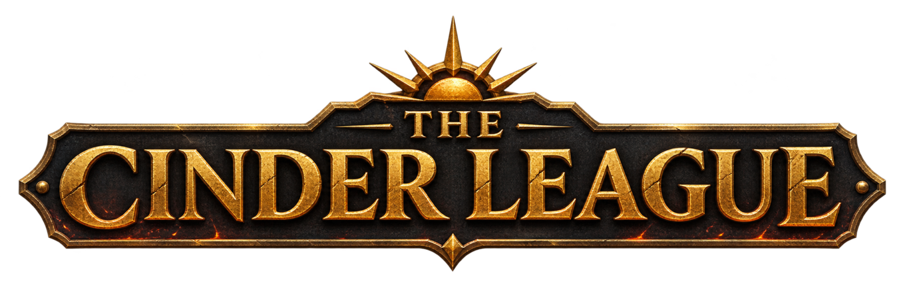
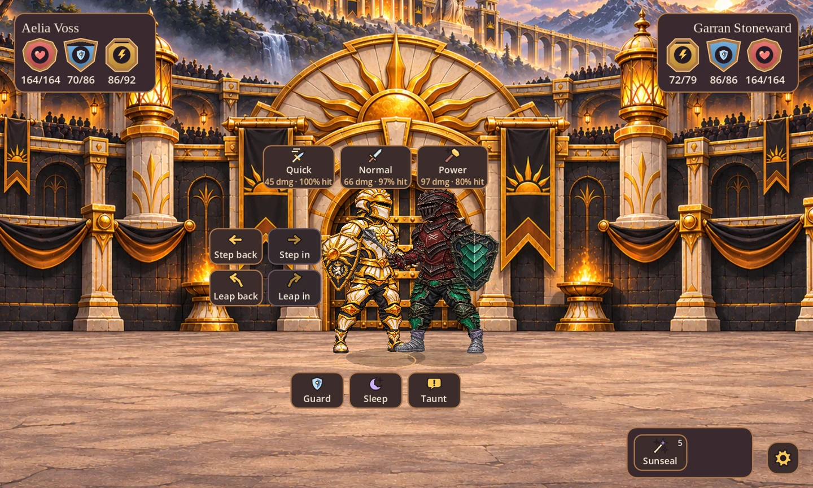

<h1 align="center">
  
</h1>

**The Cinder League** is a turn-based fantasy gladiator RPG for Linux, Windows, and macOS. You enter the Amber Ring with a dagger and a little gold. Fight for your next upgrade, then enter a tournament when you’re ready to put your career on the line.

[**Download Alpha 0.1**](https://github.com/Cees-Kettenis/the-cinder-league/releases/tag/v0.1-alpha) · [How to play](docs/how-to-play.md) · [Install guide](docs/install.md)

## How to play

1. **Make a gladiator.** Spend your starting points on the stats that suit your fighting style.
2. **Scout a fight.** Visit the Arena from town. Read your rival’s weapon reach, spells, and armor before you commit.
3. **Fight one turn at a time.** Close the distance, pick your moment to strike, and save enough stamina for the reply.
4. **Upgrade and move up.** Spend your winnings at the shops. Win tournaments to climb through the Amber Ring, Iron Court, Glass Crucible, and Suncrest Bastion.

Start with the [illustrated play guide](docs/how-to-play.md) for a walkthrough of town, shops, and your first bout.

## Install and contribute

Grab the desktop archive for your platform and extract it before launching. The [install guide](docs/install.md) covers the packaged game and running a source checkout in Godot.

To work on the game, start with [Contributing](CONTRIBUTING.md). The [docs index](docs/README.md) links to the architecture, design rules, and guides for adding and testing arenas.
