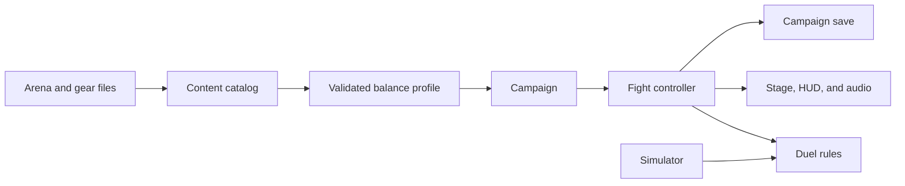

# Architecture

See [Contributing](../../CONTRIBUTING.md) for setup and [Testing](testing.md) for checks.

## Where things live

| Location | Responsibility |
| --- | --- |
| [content/arenas/](../../content/arenas/) | Arena definitions, level caps, rivals, tournaments, backdrops, and fight music |
| [content/gear/](../../content/gear/) and [content/spells/](../../content/spells/) | Gear definitions, sprites, spell effects, and cast sounds |
| [content/balance.json](../../content/balance.json) | Shared rule values, action costs, movement distances, and non-gear items |
| [game/catalog/](../../game/catalog/) | Discover content, assemble and validate balance profiles, and build fighters and loadouts |
| [game/campaign/](../../game/campaign/) | Save slots, shopping, scouting, experience, rewards, and tournament progression |
| [game/combat/](../../game/combat/) | Duel rules, fight scene, HUD, arena rendering, and rig and armor placement |
| [game/screens/](../../game/screens/) and [game/audio/](../../game/audio/) | Screen navigation, menus, shops, display settings, and shared music and sound |
| [game/simulation/](../../game/simulation/) and [tools/](../../tools/) | Headless simulation, content checks, and desktop packaging |
| [tests/playtest.gd](../../tests/playtest.gd) | Save, progression, battle, and UI regressions |

## Follow a turn

The [campaign](../../game/campaign/campaign.gd) creates a snapshot when the player enters a bout. It freezes the fighters, combat rules, equipment, seed, and rewards. The [duel engine](../../game/combat/duel.gd) validates and resolves each move. The [fight controller](../../game/combat/fight_screen.gd) records the resolved turn before starting animation. When the [stage](../../game/combat/stage.gd) signals contact, the controller updates the HUD and plays the impact sound. The simulator calls the same duel engine directly.

## Saves and deterministic results

Continuing an unfinished bout rebuilds its starting state and replays the accepted actions against the saved seed and rule snapshot. AI choices have their own random stream so replaying just the actions reproduces the combat rolls. Rival appearance also uses a separate stream.

Keep existing item IDs, categories, and armor slots stable. Append new arenas in order because saves store the arena index and tournament seeds depend on it. The balance loader also handles legacy fields, such as older lunge rules, when reconstructing a saved fight or loading an old override. If you change a shared rule, verify a fresh bout and an unfinished save made before the change.

Arena and gear additions start with their content folders. The [content catalog](../../game/catalog/content_catalog.gd) discovers them and builds one profile for the game and simulator. Follow [Add an arena](add-an-arena.md) for the file naming and progression rules.
