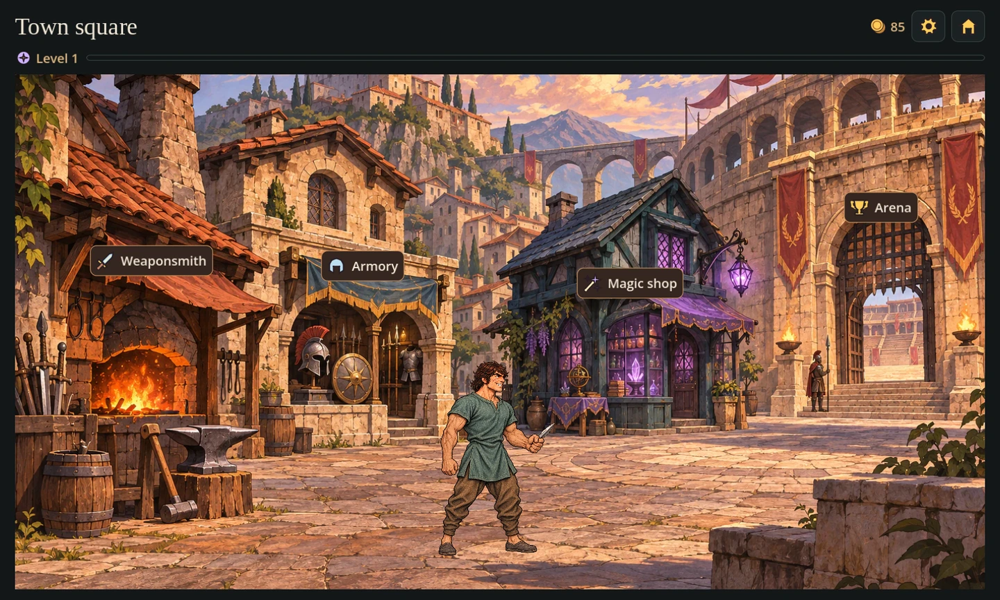
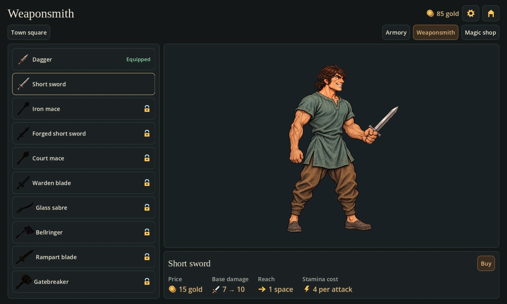
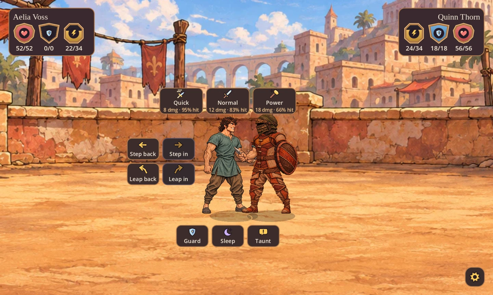

# How to play

## Create a gladiator

Choose **Play**, select a save slot, and give your gladiator a name. Spend all ten starting points to begin. **Strength** helps with melee damage and weapon requirements. **Defence** opens better armor. **Magic** opens spells, and **Stamina** helps you move and fight for longer. You can invest in several paths as you level up.

## Find your way around town

Click a building to visit it. The **Weaponsmith** and **Armory** show how the highlighted item looks and what it changes. The **Magic shop** lets you preview spell effects. Open the **Arena** when you’re ready to scout.

Your first purchase can be as simple as a short sword. Select a weapon to compare its damage, reach, and stamina cost. In the Armory, pick a slot first. The **Equipped** label marks the item you’re wearing while you browse. Check the price and stat requirement before you buy.

## Fight your first bout

1. At the Arena, choose **Scout rival**. Read the face-off to see who has more reach and whether your rival can cast. You can head back to adjust your gear before choosing **Fight**.
2. Use **Step in** or **Leap in** to get into range. **Step back** and **Leap back** can buy space for a spell or make an opponent spend a turn closing.
3. Hover over an action or focus it with the keyboard. Its preview shows what the move costs, what a clean hit can do, and why a move is unavailable. In reach, **Quick** trades damage for accuracy, **Normal** uses the weapon’s usual stats, and **Power** hits harder and can push a rival back.
4. Watch the three crests above each fighter. Armor takes damage before health. **Sleep** restores stamina and leaves you exposed for the reply. The **Pack** shows remaining casts when a spell is equipped, plus healing draughts in death matches.

Regular rivals yield below **20% health**. A loss costs some gold. Use **Next Bout** to scout a new rival, or return to town to adjust your gear. See the [combat reference](combat-reference.md) for exact ranges, stamina costs, and spell rules.

## Enter a tournament

Each arena has a level cap. At that cap, win regular bouts for gold to finish your loadout, then select **Scout tournament rival**. You can leave the face-off to prepare. Choosing **Fight to the death** commits your gladiator to the tournament. A loss ends that career.

Most rounds take place against seeded rivals before a champion with a fixed build. Knockback can send either fighter into the pit in a death match. Beat the champion to unlock the next arena and gain the experience needed to enter it.

| Arena | Levels | Tournament rounds |
| --- | --- | --- |
| Amber Ring | 1–4 | 2 |
| Iron Court | 5–8 | 3 |
| Glass Crucible | 9–12 | 4 |
| Suncrest Bastion | 13–16 | 5 |

## Keep playing

Each of the three slots saves separately and records resolved turns, so **Continue** returns you to an unfinished bout or the next tournament round. **Replace save** starts a new gladiator and archives the prior career after you finish creating the replacement. The **Hall of Fame** lists active, retired, and fallen gladiators.

| Default key | Where it helps |
| --- | --- |
| **Esc** | Open pause in town or on the title screen. Go back from shops, the arena, or an unlocked face-off or results screen. |
| **T** | Return to town when available from the results bar. |
| **N** | Scout the next bout or tournament match from the results bar. |

Use **Settings → Controls** to rebind these keys. **Settings** also offers Windowed and Fullscreen. **Audio** has separate switches for title music, town music, venue music, and game sounds.
